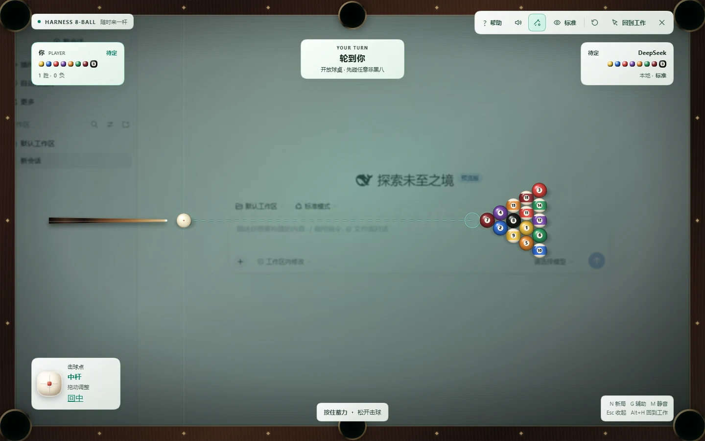
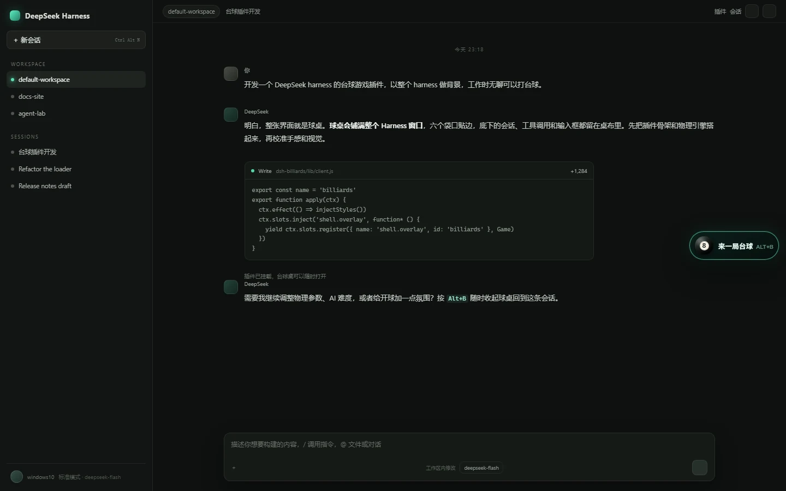
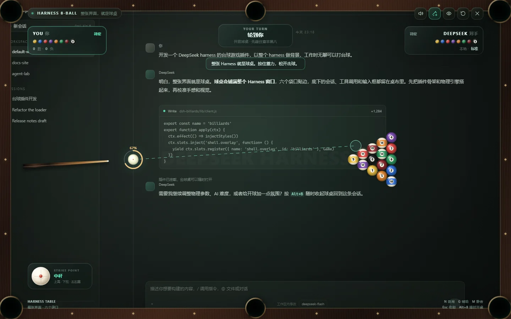
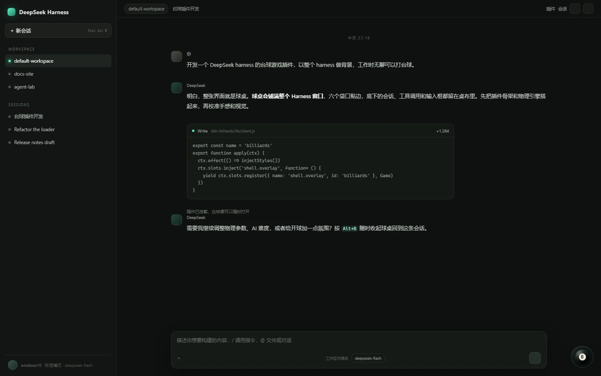
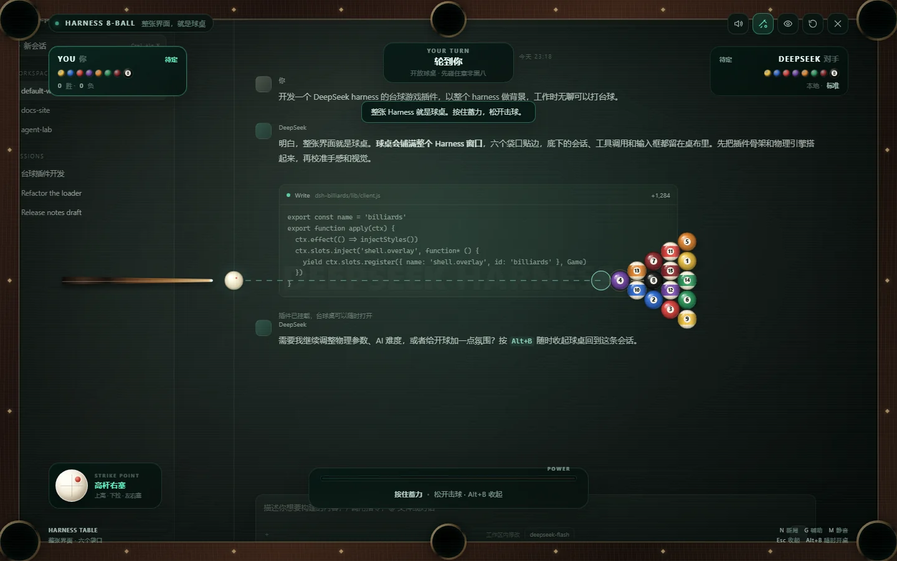
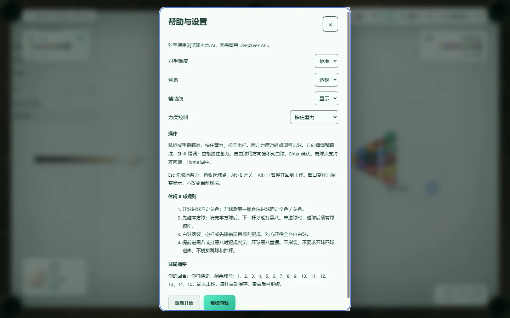

# 🎱 dsh-billiards

当前源码版本：**0.8.0**。本地 AI，无模型调用。

> **整个 Harness，就是球桌。**
>
> 一个铺满 DeepSeek Harness 窗口的 8 球台球游戏。没有弹窗、没有侧边小面板：
> 球桌的边缘就是窗口边缘，底下的会话、工具调用和输入框仍然在桌布里呼吸。
> Harness 在后台干活时，你可以随时开一局。



> 打开后的球桌铺满整个 Harness；底下的欢迎页、输入框和工具调用都还在。
> 右侧那颗 8 号球就是入口：



## 特性

- **全窗口球桌**：四个角袋 + 两个中袋贴着窗口边缘，整张 Harness 界面是半透明桌布。
- **休闲 8 球规则**：开放球桌、全色/花色分组、犯规自由球、黑八胜负、开球黑八重摆。
- **开球会真的炸开**：三角球堆是一个接触簇，每个子步对整组接触迭代求解，冲量不会被某一行「顺着带走」。满力开球有 10 颗左右球明显散开，而不是两颗球飞出去、中间一堆原地不动。
- **球号会跟着球滚**：每颗球带一个世界坐标的「号码极点」，按滚动距离 / 半径绕水平轴旋转；数字白斑投影到桌面，滚动时向前滑、到边缘压扁，另一面的号码再从对侧翻上来。停球后号码就停在当时的角度，不会自动转回正面。
- **HUD 会自己让开**：球或瞄准线经过次要面板下方时，面板淡出并让出点击；回合和双方信息保持可见，工具栏始终可操作。球和线路移开后再恢复。底部操作提示也会避让，键盘聚焦的工具栏和击球点控件保持可见。
- **有手感的瞄准与蓄力**：鼠标指向即瞄准，按住蓄力、松开击球；力度直接画在白球外圈，弧长和百分比实时变化，不再有占桌面的底部大框。
- **二维击球点与旋转**：左下角白球控件可拖到上半部（高杆跟进）、下半部（低杆拉回）或左右（加塞）；右上角就是高杆右塞。旋转会改变目标球走向、白球走向和吃库角度。
- **辅助线**：白球路径、首个接触点、目标球的出球方向；可一键关闭。
- **本地 AI 对手**：简单／标准／困难三档，选择袋口与力度，评估首碰后的白球直接落袋风险；没有进球路线时优先合法直达目标，受阻时尝试一库解球。支持自由球摆位。
- **统一磨砂玻璃 HUD**：深色主题使用清晰的浅色文字和墨绿面板，浅色主题使用白色面板和深色文字；工具栏合并，背景模式和「回到工作」带文字标识，结算页跟随深浅主题。
- **不关游戏操作 Harness**：按 `Alt+H` 或点顶部指针按钮进入操作模式；球桌和 HUD 暂时收起成右下角的 8 号球，游戏暂停，鼠标和键盘直接落到 Harness 上；再按 `Alt+H` 或点右下角 8 号球回到球桌，比分和球局都保留。
- **整页透视**：首次默认「标准」降低背景干扰，旧用户保留已有选择；「透视 / 标准 / 专注」三级可随时切换。
- **真实音效**：击球、球-球碰撞、库边、落袋均使用真实采样，以 base64 内嵌在浏览器 bundle 里，不依赖网络或 Host 路由。
- **光影**：来自左上方的 key light、木纹库边高光、球体软阴影/接触阴影、低角度反弹光、袋口金属反光，以及蓄力时白球周围的能量光圈。
- **桌面原生控件**：Windows 下 minimize / maximize / close 会随桌面一起变暗，标题栏背景透明；顶部操作栏自动避开原生按钮。
- **不碰会话**：没有模型、工具、会话、网络或 Host 路由；音频数据直接随 bundle 交付。
- **存档与键盘操作**：偏好、战绩与稳定回合存入 `localStorage`；中途重启恢复上一杆开始前。支持键盘自由球摆位、ARIA 状态广播、减少动态效果；损坏或未知版本存档安全降级。

## 安装

### 桌面应用 / `dsh web`

在 DeepSeek Harness 安装目录的 `resources/runtime/cli/bin/` 下使用自带 CLI：

```sh
dsh plugin --profile desktop add <path-to-dsh-billiards>
# 或者 dsh web 的 profile：
dsh plugin --profile web add <path-to-dsh-billiards>
```

本地源码目录可以直接用绝对路径安装：

```sh
dsh plugin --profile desktop add "file:C:/Users/you/.../dsh-billiards"
```

> 安装后需要**重开桌面应用**（`dsh web` 则重启 `dsh web`）才会加载新的插件行。
> 插件包含一个空实现的 Host 半侧和完整的浏览器 bundle；两者都在启动时组装。

也可以发布到 npm 后直接：

```sh
dsh plugin --profile web add dsh-billiards
```

### 打开游戏

- 页面**右下角**会出现一颗悬浮的 **8 号球**，点击打开；
- 或按 **`Alt + B`** 随时开桌 / 收桌。

## 操作

| 操作 | 说明 |
| --- | --- |
| 移动鼠标 | 瞄准（从白球指向鼠标方向） |
| 按住左键 | 蓄力，白球外圈显示 0–100% 力度环 |
| 松开左键 | 击球 |
| `空格` | 键盘蓄力 / 松开击球 |
| `←` `→` | 微调瞄准角度（按住 `Shift` 更细） |
| `↑` `↓` | 粗调角度 |
| 右键 / `Esc` | 取消蓄力；`Esc` 再按一次收起球桌 |
| `N` | 新的一局；进行中的球局先确认 |
| `G` | 显示 / 隐藏辅助线 |
| `M` | 静音 / 取消静音 |
| 右上角眼睛按钮 | 背景「透视 → 标准 → 专注」三级切换 |
| `Alt + H` | 进入 / 退出 Harness 操作模式（不关闭球桌） |
| 顶部指针按钮 | 进入 Harness 操作模式；右下角 8 号球可返回 |
| 左下角白球控件 | 拖动设置击球点；双击回中杆 |
| `Alt + B` | 随时打开 / 收起球桌 |
| 自由球时点击桌面 | 放置白球（自动吸附到最近合法位置） |
| 自由球时方向键 / Enter | 移动白球预览 / 确认；Shift 精调 |
| 帮助与设置 | 规则、球局摘要、上一杆原因、难度、背景、辅助线与固定力度 |

蓄力时底部不再出现大框：力度直接画在白球外圈，弧长和中间百分比同步增长。



## Harness 操作模式

按 `Alt+H` 或点顶部指针按钮后，球桌和 HUD 会暂时收起，游戏暂停，鼠标和键盘直接落到
下面的 Harness 页面。右下角会出现同一颗 8 号球，点它或再按 `Alt+H` 就回到球桌；
球局、比分和击球点都会保留。



## 击球点与旋转

左下角的迷你白球就是**击球点**：红点可以拖到白球的任意位置，双击回到中心。



| 击球点 | 名称 | 实际效果 |
| --- | --- | --- |
| 中心 | 中杆 | 标准碰撞，白球撞击后基本停住或按切线走 |
| 上半部 | 高杆 | 白球撞击目标球后继续向前跟进（follow） |
| 下半部 | 低杆 | 白球撞击后向后拉回（draw） |
| 左半部 | 左塞 | 目标球向出球方向左侧偏，白球向右偏；吃库反弹角变化 |
| 右半部 | 右塞 | 目标球向出球方向右侧偏，白球向左偏；吃库反弹角变化 |
| 右上角 | 高杆右塞 | 跟进 + 目标球向右偏 + 白球向左偏 + 吃库角度变化 |
| 左下角 | 低杆左塞 | 拉回 + 目标球向左偏 + 白球向右偏 + 吃库角度变化 |

侧塞也会让白球在吃库后改变反弹角，旋转会随时间衰减。击球点越靠边、力度越大，跟进/拉回和带偏越明显；当前调校下满力高杆与低杆的停点可拉开约 4–5 个球径，侧塞对目标球的带偏约 7°。这是 2D 台面模型：
不模拟跳球、扎杆、弧线球（masse）和真正的三维球体旋转，但跟进、拉回、目标球带偏和吃库塞已经实际参与物理计算。

## 规则

按常见 8 球规则实现：

1. 开球后球桌保持开放；**开球进球不定花色**，开球方可以继续击球，但花色要等开球后第一颗合法落袋的非黑八球才确定。
2. 球桌开放时，犯规的同时进球也不定花色（球留在袋里，球桌继续开放）。
3. 合法进球可以继续击球；未进球或犯规则交换球权。
4. 犯规包括：白球落袋、空杆、先碰对方花色、先碰黑八（未到打黑八时）、碰球后没有球碰库且没有进球。
5. 犯规后对手获得**自由球**，可把白球放在桌面任意合法位置。
6. 清完自己花色后，打进黑八即获胜；提前打进黑八、或打黑八时白球落袋，判负。
7. 开球打进黑八会重新摆球（不判负）。

AI 采用保守的袋口规划：先找自己花色中「切球角度可接受、白球路径和目标球路径都没有遮挡」的组合，再按滚动阻力、切球损失和行程反算力度；偶尔会加入瞄准误差。没有可进球线路时，优先击打可直达的合法目标球。

### 简化说明

为了保持「随手打一局」的节奏，以下细节采用常见休闲规则，而不是职业赛规则：

- 不强制开球「四球碰库」；只按普通击球的碰库 / 进球规则判断。
- 开球黑八使用**重摆**，不采用「黑八放回置球点」。
- 不要求指袋；黑八进任意袋都算。
- 犯规自由球可放全台（含开球时白球落袋后的自由球）。
- 不模拟跳球、球离开台面、连击、推杆等物理犯规。
- 球的号码按三维极点滚动，但**花色条纹本身不跟着翻面**，只作为花色标识；真正让条纹
  也滚动需要把球当球面贴图渲染，属于后续可做的视觉升级。

## 架构

```text
dsh-billiards/
├── lib/
│   ├── index.js       # Host 半侧：空实现
│   ├── client.js      # 浏览器半侧：完整游戏（由 src 构建，含内嵌音效）
│   └── audio/         # 采样源文件 + 来源/许可说明
├── src/              # 输入、存储、规则、物理、AI、渲染、宿主与 UI 源码
├── tools/            # 无外部依赖的构建脚本、独立预览页面
├── test/             # 生产 bundle 回归、浏览器、完整对局与基准
├── cordis.patch.yml   # bundle patch：挂载 dsh-billiards 插件行
├── icon.png           # 插件图标（256px）
├── package.json
├── README.md
└── LICENSE
```

### Host 半侧

`lib/index.js` 导出稳定的 Cordis `name` / `inject` / `apply`，但 `apply` 是空实现。
没有路由、模型、工具、会话、文件监听或 RPC。音频 WAV 直接以 base64 内嵌在
`client.js` 里，第一次打开球桌时由 WebAudio 解码；因此不会出现 Host 路由未注册、
缓存旧文件或网络失败时退回合成音的问题。

### 浏览器半侧

`lib/client.js` 是 DSH 模块系统的经典脚本 bundle：

```js
window.__ModuleLoader__.load({ id: 'dsh-billiards', factory })
```

工厂只向 shell 请求 `react`，然后把游戏组件注册到：

```js
ctx.slots.register({ name: 'shell.overlay', id: 'billiards', order: 900 }, Game)
```

因此它天然覆盖整个 Harness，且不会和宿主的页面路由、会话 store 或输入框抢状态。

球桌渲染使用可见 Canvas 与离屏缓存：

- **离屏静态缓存**：只在窗口尺寸变化时重绘木纹库边、袋口、钻石标记、球台水印和光影。
- **可见画布**：每帧绘制球、球杆、辅助线、粒子、球体接触阴影和袋口动画。

物理以 `1/2400s` 子步推进。球-球碰撞先把本子步里所有重叠的球对收集成一张接触表，
再对整张表迭代 4 轮求解：每对球按累积法向冲量和目标分离速度（恢复系数 0.955）结算，
最后统一修正位置。只碰到一颗球时一轮即收敛，所以普通击球手感和原来完全一致；
开球时十几颗球同时接触，则会一起分担冲量，而不是让某一行球替整堆挨打。
球堆按 2.004r 的间距摆成「贴紧」的三角（真实球堆就是碰着的），并带 ±0.04r 的随机
摆位误差和一次防重叠松弛，因此每一局的开球都不完全相同。
球号不是贴在屏幕上的贴图：每颗球有一个世界坐标的单位向量 `pole`，表示号码斑点的朝向，
按「滚动距离 / 半径」绕行进方向的水平轴旋转；绘制时取朝上的那个极点（号码印在
对跖两面），投影成随位置移动、随倾角压扁的白斑和数字。所以快球号码会快速翻转，
停球后号码停在停下时的角度。

HUD 是浮在桌面上的独立 DOM 层。`measureHud()` 在开局、窗口变化和 HUD 文案变化时缓存
每个面板的视口矩形；`updateHudOcclusion()` 每帧用圆-矩形（球）和 Liang-Barsky
线段-矩形（瞄准线）测试一次，给被压住的面板打 `data-occluded="true"`，CSS 只做
`opacity: 0` + `pointer-events: none`，不改布局，所以不会触发重排或抖动。
库边带恢复系数；摩擦力由「恒定滚动阻力 + 与速度成正比的桌布阻力」组成，因此开球有爆发力，
轻推又会自然停住。击球点用三个标量参与结算：`spinY` 给白球跟进/拉回冲量，
`spinX` 给目标球带偏、白球反向偏和吃库反弹角，二者都按时间衰减。
犯规/分组/球权由一个轻量规则状态机结算。AI 根据当前球位和阻力参数规划出杆，
走与玩家相同的击球接口。

### 数据

只使用一个 `localStorage` 键：`dsh-billiards.v1`。没有任何网络请求、遥测或模型调用；
音效随 bundle 一起交付。

### 音效来源

5 个 WAV 来自 [Freesound](https://freesound.org/) 的 CC0 / CC BY 4.0 采样，
经过去静音、单声道混合、归一化和淡入淡出；库边音额外叠加了一层短促的干球点击。
它们以 base64 内嵌在客户端 bundle 中；`lib/audio/` 保留原始 WAV 以便重新生成和审计。
完整作者、链接和许可见 [`lib/audio/CREDITS.md`](lib/audio/CREDITS.md)。

## 本地开发

`lib/client.js` 末尾带一个只在 `window.__DSH_BILLIARDS_PREVIEW__ === true` 时
生效的预览分支。仓库的 `tools/preview.html` 是一个模拟 Harness 页面，可直接
用浏览器打开，完全绕过 Cordis 和模块加载器：

```sh
# 打开 tools/preview.html 即可
```

显式设置 `window.__DSH_BILLIARDS_DEBUG__ = true`（在插件加载前）或启用预览模式后，才暴露调试句柄：

```js
window.__DSH_BILLIARDS__.open()
window.__DSH_BILLIARDS__.state()
window.__DSH_BILLIARDS__.shoot(angle, power)
window.__DSH_BILLIARDS__.advance(seconds)
```

调试句柄只用于本地验证，不参与游戏逻辑。

## 0.7.1 界面调整

- 提高玩家卡、回合状态、击球点和提示文字的对比度；桌面提示文字以 11–14px 为主，回合标题 17px，统一面板间距和圆角。
- 将分散的工具按钮合并到同一面板；宽窗口直接显示「透视 / 标准 / 专注」和「回到工作」，窄窗口收成图标；静音标题和可访问名称与当前状态同步。
- 恢复简短的底部操作提示，蓄力时明确显示「松开击球 / Esc 取消」；击球点控件改用中文说明。底部提示沿用球和瞄准线的避让机制。
- 删除覆盖整页的重复网格纹理，保留透明背景、木质库边、球体和光影。
- 700px 以下重新排列工具栏、回合卡和双方球组，收起次要战绩；短窗口采用紧凑布局；Windows 标题栏单独避让。
- 结算页提高字号和按钮高度，浅色主题使用白色卡片；窄窗口按钮纵向排列，短窗口压缩留白，键盘焦点轮廓更明确。
- 独立预览补齐真实浅色背景和响应式模拟页面，避免用深色背景误判浅色主题的可读性。

验证：22 项基础回归通过；Chromium 中检查 10 组横竖屏 / 主题场景、6 组原生标题栏加花色分组场景，
主面板没有相互重叠、越界或文字横向溢出；检查深浅主题、静音文案、遮挡避让和键盘聚焦，运行时异常为 0。
结算页检查了桌面、390px 竖屏、900×400 短窗口，以及 320px 的败局文案；截图已检查。
这些检查使用独立预览页面，真实 Harness 重启后的装载和标题栏仍需宿主验证。

## 0.7.0 分析与优化（2026-11-11）

本次检查覆盖插件装载、物理和旋转、8 球规则、AI、渲染与 HUD、输入与焦点、持久化、音频卸载和发布文件。
继续采用浏览器本地游戏架构，无新增依赖、模型调用或网络请求。

| 范围 | 发现的问题 | 已完成的优化 |
| --- | --- | --- |
| 输入 | Esc 蓄力时直接收桌；非所属指针、鼠标副键或键盘松开可能触发出杆 | Esc 先取消；绑定蓄力输入来源和指针；丢失捕获或焦点时取消；按键连发不重复重开、切换 |
| 宿主共存 | 全局捕获监听可能拦截宿主弹窗和 Ctrl / Meta 组合键 | 普通游戏键限定球桌焦点范围；跳过组合键和 IME；保留 Alt+B / Alt+H 全局入口 |
| 渲染 | 静止球桌持续重绘；同帧重复算瞄准线；进球更新 HUD 时同步测布局 | 静止时停止申请动画帧，输入按需唤醒；复用同帧瞄准结果；HUD 测量合并到绘制前；后台页面暂停 |
| 物理 | 每子步创建接触对象；袋口检测频繁开方 | 复用接触缓存，球对先做包围盒排除，袋口改用距离平方；保留 1/2400s 子步、4 轮接触簇求解和旋转参数 |
| AI | 力度按固定像素距离估算，短球过猛；无袋口路线时选球受数组顺序影响 | 按阻力模型和切球损失反算力度；优先可达目标；自由球评估覆盖全部合法候选，摆位后清理旧落袋和旋转状态 |
| 缩放与 HUD | 窄窗口面板互相覆盖；缩放后球位可能挤入库边，AI 沿用旧计划 | 320 / 390px 自适应布局；位置边界修正和有限轮分离；重新规划 AI / 自由球；尺寸和像素比未变时复用画布 |
| 生命周期与可访问性 | 延迟音符和异步解码可能在卸载后继续；样式清理依赖调试句柄；隐藏控件仍可聚焦 | 清理音频定时器、解码结果和开场提示；样式引用计数；隐藏入口及球桌使用 inert；结果页聚焦与 Tab 循环；焦点内控件保持可见 |
| 状态一致性 | 重复结算可能重复计分；AI 定花色时提示人类的花色错误 | 终局结算幂等；提示使用人类实际分组；过滤非法击球数值；统计计数读取时取非负整数；更新过时音频路由说明 |

### 验证与测量

- **22 项自动回归通过**：直接装载生产 bundle 的规则和物理，不维护另一份仿真实现；覆盖开球、分组、犯规、黑八、旋转、能量上界、输入、调度、缩放、音频卸载和 Cordis 注册。
- **Chromium 浏览器验证通过**：真实鼠标和键盘事件、宿主原生 dialog、结果按钮空格操作、Alt+H 暂停恢复、主题变化、窗口缩放及 HUD 矩形检查；1440×900 深浅主题、390×844、320×640 截图已人工检查，捕获到的运行时异常为 0。
- 页面隐藏测试通过覆盖 `document.hidden` 并派发 `visibilitychange` 检查处理器；真实浏览器后台节流和 Electron 最小化仍需宿主验证。
- **5 个固定种子完整对局**：双方均使用内置 AI 接口，分别在 31、32、32、32、29 杆内以合法黑八结束，没有停滞或非有限数值。
- **36 个短距离 AI 场景**：覆盖三种横竖屏尺寸，标准随机瞄准模式下，优化前后均为 36/36 进球、0 犯规；平均力度约由 0.400 降至 0.120。此结果只说明这些场景的短球控制，不代表整体胜率提升。
- **生产物理微基准**：以 `b7b7d6e` 为基线，固定随机种子，预热 2 次后取 7 次完整开球计算的中位数；本机一次对照为 **125.00 → 100.11 ms（约减少 20%）**，该轮末局有 12 颗目标球位移超过 150px。时间受机器和负载影响，这不是 FPS 或宿主 CPU 占用测试。
- `node --check`、`git diff --check` 与 `npm pack --dry-run` 通过；测试代码和浏览器临时文件不会进入插件包。

在源码目录运行：

```sh
npm test
npm run test:games
npm run test:browser
npm run benchmark -- --baseline b7b7d6e
npm run benchmark:ai -- --baseline b7b7d6e
```

基础测试与完整对局只需 Node.js，无需安装依赖。浏览器测试自动寻找本机 Chrome / Edge / Chromium，
其他路径可用 `BILLIARDS_BROWSER` 环境变量指定。截图和结果写到忽略的 `.test-artifacts/`，
独立浏览器 profile 在退出时清理；不会使用日常浏览器的游戏存档。

### 适用边界

这次验证在本地源码、独立 Chromium 和模拟 Harness 背景中完成，没有重启当前 DeepSeek Harness，
也没有重新验证真实 Electron 标题栏或新版 DSH 的装载兼容性。已有桌面 profile 的本地依赖内容已跟随源码更新，
运行中的宿主仍需重启才能重新装载 bundle。服务器文件没有改动。

以下为 0.7.0 的历史验证记录。0.8.0 的结果和适用边界见下文。

游戏继续采用上述休闲 8 球规则与二维旋转近似；AI 仍是几何启发式规划，不含多杆搜索、完整解球策略或大模型调用。
0.7.0 的缩放采用有限分离；0.8.0 已改为相机缩放，保留整局物理坐标。

## 0.8.0 完整性优化

- **键盘闭环**：自由球支持方向键移动、Shift 精调、Enter／空格确认，非法位置不能放球。
- **稳定缩放**：每局固定物理几何，窗口变化只调整等比相机；横竖屏切换可旋转显示。极端长宽比允许留白，球位、速度、碰撞和 AI 计划不因缩放改变。
- **回合存档**：稳定回合和出杆前保存球局；重载恢复最近一杆开始前。终局清除存档，避免恢复已结束球局；新局清除旧存档。存档包含版本与规则标识，拒绝损坏和非法数据。
- **误操作与原因**：有击球记录的未完成球局重开时确认；帮助与确认面板暂停物理和 AI，关闭后继续。对手提前进黑八等胜负原因准确显示。
- **关键入口**：工具栏始终可用；回合与双方信息只降低透明度。移动端保留「工作」文字和 44px 触摸按钮，次要设置收进帮助面板，击球点增加明确的回中按钮。
- **帮助与设置**：游戏内提供休闲规则、快捷键、球局摘要与上一杆原因；三档本地 AI 和可选固定力度均保存偏好。首次默认标准背景，既有偏好继续保留。
- **宿主与容错**：标题栏标记消失仍恢复备份，不覆盖宿主更新的 inline 值；卸载幂等；Canvas 初始化失败局部提示并清理；运行时跟随减少动态效果设置。调试入口改为显式启用。
- **可复现交付**：源码分为 11 个职责文件，构建脚本直接从 WAV 生成内嵌音效与经典脚本；预览页面已纳入仓库。CI 配置覆盖构建一致性、回归、完整对局、浏览器与打包。

请在 Git 源码检出中开发，使用 Node.js 22 或以上；已发布安装包直接使用 `lib/client.js`，无需构建或下载运行时依赖。

```sh
npm run build
npm run check
npm run test:games
npm run test:browser
npm pack --dry-run
```

修改 `src/` 后运行构建，不要手工修改生成的 `lib/client.js`。`npm run check` 会拒绝过时 bundle。
独立预览位于 `tools/preview.html`；缺少预览夹具会直接报错。测试入口显式加载整个生产 bundle，不再按字符串截断当前版本。

如需在隔离的本机 Harness Web 中运行同一套浏览器回归，先在独立 `DSH_HOME` 安装并启动插件，再设置 `BILLIARDS_HOST_URL` 为该实例的本机地址。该地址可能包含临时访问令牌，不要提交到仓库或发布日志。

本轮验证：34 项回归通过；36 个短球场景全部进球且无犯规；浏览器覆盖 10 组尺寸／主题、6 组标题栏布局、键盘摆球、重开确认、设置保存、真实页面重载恢复和 10 次挂载／销毁。源码安装与实际 tgz 安装均在隔离的 Harness Web 验证，运行时异常为 0。完整对局使用 20 个固定种子，覆盖三种尺寸与三档难度。



**验证边界**：自动化覆盖独立 Chromium 与隔离的 Harness Web；Windows 原生 Electron 标题栏、真实最小化、跨显示器缩放和真实审批流程仍须桌面专项验收。未进行模型调用，也未改动当前桌面 profile。AI 风险评估为单次接触近似，一库解球不等于完整解球搜索。

## 兼容性

- DeepSeek Harness **0.2.2-rc.1**（本轮隔离 Web 安装与浏览器回归通过）
- **0.2.1-rc.2** 为此前声明兼容版本，本轮未重新启动该版本验证。
- React 18（由 DSH shell 提供）
- 现代 Chromium / Electron：Canvas 2D、`backdrop-filter`、WebAudio（可选）

## License

[MIT](./LICENSE)
