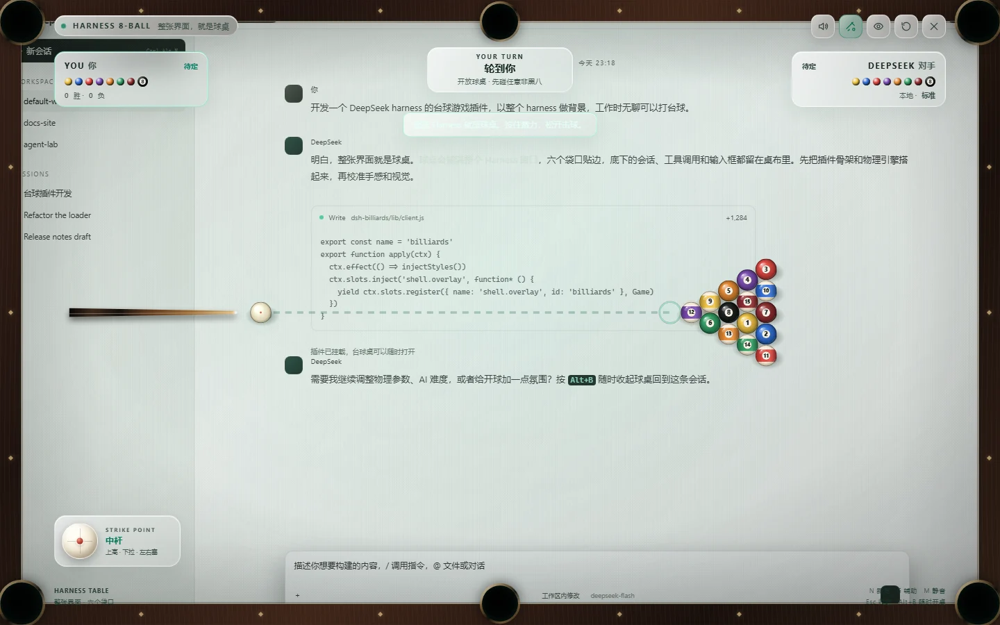
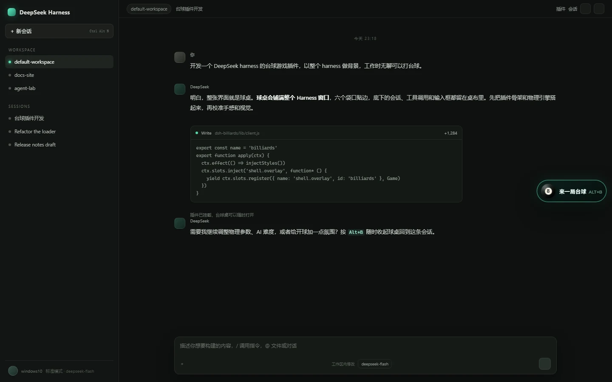
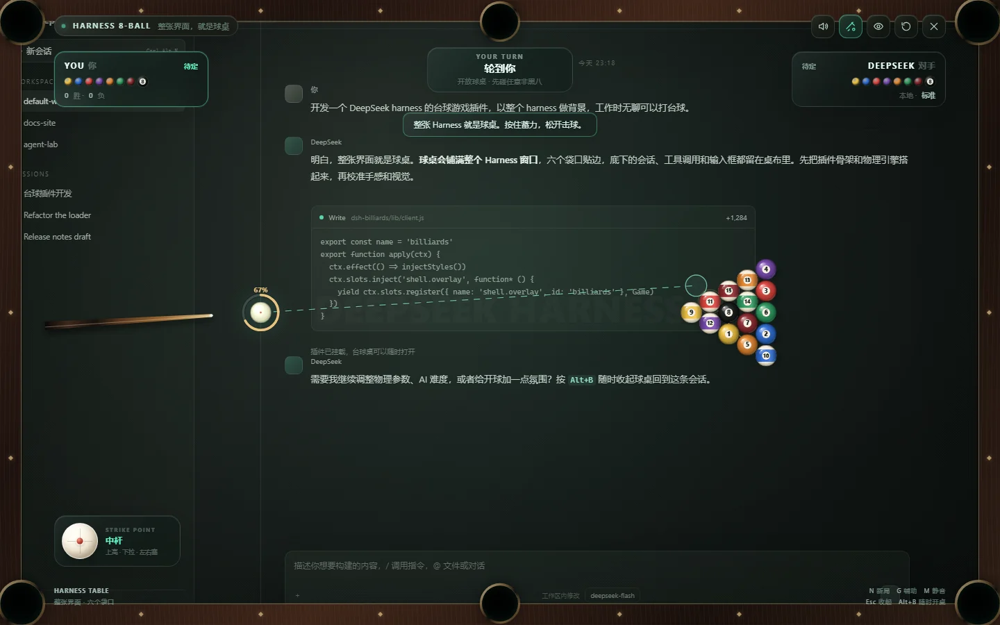
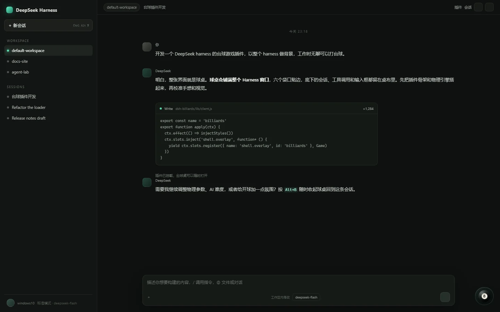
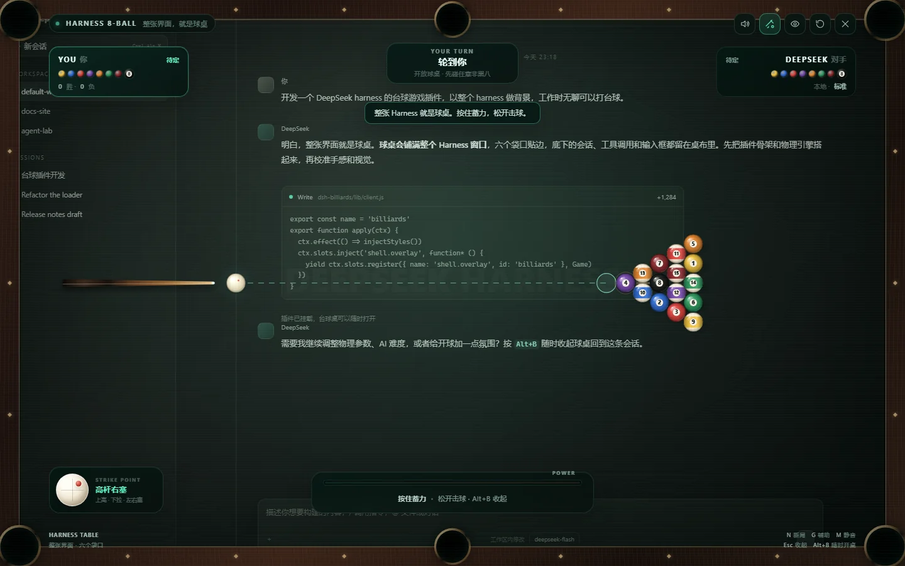

# 🎱 dsh-billiards

> **整个 Harness，就是球桌。**
>
> 一个铺满 DeepSeek Harness 窗口的 8 球台球游戏。没有弹窗、没有侧边小面板：
> 球桌的边缘就是窗口边缘，底下的会话、工具调用和输入框仍然在桌布里呼吸。
> Harness 在后台干活时，你可以随时开一局。



> 打开后的球桌铺满整个 Harness；底下的欢迎页、输入框和工具调用都还在。
> 右侧那颗 8 号球就是入口：



## 特性

- **全窗口球桌**：四个角袋 + 两个中袋贴着窗口边缘，整张 Harness 界面是半透明桌布。
- **真实 8 球规则**：开放球桌、全色/花色分组、犯规自由球、黑八胜负、开球黑八重摆。
- **开球会真的炸开**：三角球堆是一个接触簇，每个子步对整组接触迭代求解，冲量不会被某一行「顺着带走」。满力开球有 10 颗左右球明显散开，而不是两颗球飞出去、中间一堆原地不动。
- **球号会跟着球滚**：每颗球带一个世界坐标的「号码极点」，按滚动距离 / 半径绕水平轴旋转；数字白斑投影到桌面，滚动时向前滑、到边缘压扁，另一面的号码再从对侧翻上来。停球后号码就停在当时的角度，不会自动转回正面。
- **有手感的瞄准与蓄力**：鼠标指向即瞄准，按住蓄力、松开击球；力度直接画在白球外圈，弧长和百分比实时变化，不再有占桌面的底部大框。
- **真实击球点**：左下角白球控件可拖到上半部（高杆跟进）、下半部（低杆拉回）或左右（加塞）；右上角就是高杆右塞。旋转会改变目标球走向、白球走向和吃库角度。
- **辅助线**：白球路径、首个接触点、目标球的出球方向；可一键关闭。
- **DeepSeek 对手**：会找球、算袋口、选择力度，也会偶尔打丢；支持自由球摆位。
- **半透明磨砂玻璃 HUD**：卡片、球权条、击球点和按钮都是半透明玻璃；深色主题用烟熏玻璃，浅色主题自动切成白色磨砂玻璃 + 深色文字。
- **不关游戏操作 Harness**：按 `Alt+H` 或点顶部指针按钮进入操作模式；球桌和 HUD 暂时收起成右下角的 8 号球，游戏暂停，鼠标和键盘直接落到 Harness 上；再按 `Alt+H` 或点右下角 8 号球回到球桌，比分和球局都保留。
- **整页透视**：默认几乎完全透出 Harness 页面；「透视 / 标准 / 专注」三级可随时切换。
- **真实音效**：击球、球-球碰撞、库边、落袋均使用真实采样，以 base64 内嵌在浏览器 bundle 里，不依赖网络或 Host 路由。
- **光影**：来自左上方的 key light、木纹库边高光、球体软阴影/接触阴影、低角度反弹光、袋口金属反光，以及蓄力时白球周围的能量光圈。
- **桌面原生控件**：Windows 下 minimize / maximize / close 会随桌面一起变暗，标题栏背景透明；顶部操作栏自动避开原生按钮。
- **不碰会话**：没有模型、工具、会话、网络或 Host 路由；音频数据直接随 bundle 交付。
- **轻量持久化 + 可访问性**：胜负、连胜、静音、辅助线、背景级别存入 `localStorage`；支持键盘、ARIA 状态广播、减少动态效果。

## 安装

### 桌面应用 / `dsh web`

在 DeepSeek Harness 安装目录的 `resources/runtime/cli/bin/` 下使用自带 CLI：

```sh
dsh plugin --profile desktop add <path-to-dsh-billiards>
# 或者 dsh web 的 profile：
dsh plugin --profile web add <path-to-dsh-billiards>
```

本地源码目录可以直接用绝对路径安装：

```sh
dsh plugin --profile desktop add "file:C:/Users/you/.../dsh-billiards"
```

> 安装后需要**重开桌面应用**（`dsh web` 则重启 `dsh web`）才会加载新的插件行。
> 插件包含一个空实现的 Host 半侧和完整的浏览器 bundle；两者都在启动时组装。

也可以发布到 npm 后直接：

```sh
dsh plugin --profile web add dsh-billiards
```

### 打开游戏

- 页面**右下角**会出现一颗悬浮的 **8 号球**，点击打开；
- 或按 **`Alt + B`** 随时开桌 / 收桌。

## 操作

| 操作 | 说明 |
| --- | --- |
| 移动鼠标 | 瞄准（从白球指向鼠标方向） |
| 按住左键 | 蓄力，白球外圈显示 0–100% 力度环 |
| 松开左键 | 击球 |
| `空格` | 键盘蓄力 / 松开击球 |
| `←` `→` | 微调瞄准角度（按住 `Shift` 更细） |
| `↑` `↓` | 粗调角度 |
| 右键 / `Esc` | 取消蓄力；`Esc` 再按一次收起球桌 |
| `N` | 新的一局（任意时刻） |
| `G` | 显示 / 隐藏辅助线 |
| `M` | 静音 / 取消静音 |
| 右上角眼睛按钮 | 背景「透视 → 标准 → 专注」三级切换 |
| `Alt + H` | 进入 / 退出 Harness 操作模式（不关闭球桌） |
| 顶部指针按钮 | 进入 Harness 操作模式；右下角 8 号球可返回 |
| 左下角白球控件 | 拖动设置击球点；双击回中杆 |
| `Alt + B` | 随时打开 / 收起球桌 |
| 自由球时点击桌面 | 放置白球（自动吸附到最近合法位置） |

蓄力时底部不再出现大框：力度直接画在白球外圈，弧长和中间百分比同步增长。



## Harness 操作模式

按 `Alt+H` 或点顶部指针按钮后，球桌和 HUD 会暂时收起，游戏暂停，鼠标和键盘直接落到
下面的 Harness 页面。右下角会出现同一颗 8 号球，点它或再按 `Alt+H` 就回到球桌；
球局、比分和击球点都会保留。



## 击球点与旋转

左下角的迷你白球就是**击球点**：红点可以拖到白球的任意位置，双击回到中心。



| 击球点 | 名称 | 实际效果 |
| --- | --- | --- |
| 中心 | 中杆 | 标准碰撞，白球撞击后基本停住或按切线走 |
| 上半部 | 高杆 | 白球撞击目标球后继续向前跟进（follow） |
| 下半部 | 低杆 | 白球撞击后向后拉回（draw） |
| 左半部 | 左塞 | 目标球向出球方向左侧偏，白球向右偏；吃库反弹角变化 |
| 右半部 | 右塞 | 目标球向出球方向右侧偏，白球向左偏；吃库反弹角变化 |
| 右上角 | 高杆右塞 | 跟进 + 目标球向右偏 + 白球向左偏 + 吃库角度变化 |
| 左下角 | 低杆左塞 | 拉回 + 目标球向左偏 + 白球向右偏 + 吃库角度变化 |

侧塞也会让白球在吃库后改变反弹角，旋转会随时间衰减。击球点越靠边、力度越大，跟进/拉回和带偏越明显；当前调校下满力高杆与低杆的停点可拉开约 4–5 个球径，侧塞对目标球的带偏约 7°。这是 2D 台面模型：
不模拟跳球、扎杆、弧线球（masse）和真正的三维球体旋转，但跟进、拉回、目标球带偏和吃库塞已经实际参与物理计算。

## 规则

按常见 8 球规则实现：

1. 开球后球桌保持开放；**开球进球不定花色**，开球方可以继续击球，但花色要等开球后第一颗合法落袋的非黑八球才确定。
2. 球桌开放时，犯规的同时进球也不定花色（球留在袋里，球桌继续开放）。
3. 合法进球可以继续击球；未进球或犯规则交换球权。
4. 犯规包括：白球落袋、空杆、先碰对方花色、先碰黑八（未到打黑八时）、碰球后没有球碰库且没有进球。
5. 犯规后对手获得**自由球**，可把白球放在桌面任意合法位置。
6. 清完自己花色后，打进黑八即获胜；提前打进黑八、或打黑八时白球落袋，判负。
7. 开球打进黑八会重新摆球（不判负）。

AI 采用保守的袋口规划：先找自己花色中「切球角度可接受、白球路径和目标球路径都没有遮挡」的组合，再按距离选择力度；偶尔会加入瞄准误差或选择防守线路。

### 简化说明

为了保持「随手打一局」的节奏，以下细节采用常见休闲规则，而不是职业赛规则：

- 不强制开球「四球碰库」；只按普通击球的碰库 / 进球规则判断。
- 开球黑八使用**重摆**，不采用「黑八放回置球点」。
- 不要求指袋；黑八进任意袋都算。
- 犯规自由球可放全台（含开球时白球落袋后的自由球）。
- 不模拟跳球、球离开台面、连击、推杆等物理犯规。
- 球的号码按三维极点滚动，但**花色条纹本身不跟着翻面**，只作为花色标识；真正让条纹
  也滚动需要把球当球面贴图渲染，属于后续可做的视觉升级。

## 架构

```text
dsh-billiards/
├── lib/
│   ├── index.js       # Host 半侧：空实现
│   ├── client.js      # 浏览器半侧：完整游戏（含内嵌音效，无构建步骤）
│   └── audio/         # 采样源文件 + 来源/许可说明
├── cordis.patch.yml   # bundle patch：挂载 dsh-billiards 插件行
├── icon.png           # 插件图标（256px）
├── package.json
├── README.md
└── LICENSE
```

### Host 半侧

`lib/index.js` 导出稳定的 Cordis `name` / `inject` / `apply`，但 `apply` 是空实现。
没有路由、模型、工具、会话、文件监听或 RPC。音频 WAV 直接以 base64 内嵌在
`client.js` 里，第一次打开球桌时由 WebAudio 解码；因此不会出现 Host 路由未注册、
缓存旧文件或网络失败时退回合成音的问题。

### 浏览器半侧

`lib/client.js` 是 DSH 模块系统的经典脚本 bundle：

```js
window.__ModuleLoader__.load({ id: 'dsh-billiards', factory })
```

工厂只向 shell 请求 `react`，然后把游戏组件注册到：

```js
ctx.slots.register({ name: 'shell.overlay', id: 'billiards', order: 900 }, Game)
```

因此它天然覆盖整个 Harness，且不会和宿主的页面路由、会话 store 或输入框抢状态。

球桌渲染使用两层 Canvas：

- **静态层**：只在窗口尺寸变化时重绘木纹库边、袋口、钻石标记、球台水印和光影。
- **动态层**：每帧绘制球、球杆、辅助线、粒子、球体接触阴影和袋口动画。

物理以 `1/2400s` 子步推进。球-球碰撞先把本子步里所有重叠的球对收集成一张接触表，
再对整张表迭代 4 轮求解：每对球按累积法向冲量和目标分离速度（恢复系数 0.955）结算，
最后统一修正位置。只碰到一颗球时一轮即收敛，所以普通击球手感和原来完全一致；
开球时十几颗球同时接触，则会一起分担冲量，而不是让某一行球替整堆挨打。
球堆按 2.004r 的间距摆成「贴紧」的三角（真实球堆就是碰着的），并带 ±0.04r 的随机
摆位误差和一次防重叠松弛，因此每一局的开球都不完全相同。
球号不是贴在屏幕上的贴图：每颗球有一个世界坐标的单位向量 `pole`，表示号码斑点的朝向，
按「滚动距离 / 半径」绕行进方向的水平轴旋转；绘制时取朝上的那个极点（号码印在
对跖两面），投影成随位置移动、随倾角压扁的白斑和数字。所以快球号码会快速翻转，
停球后号码停在停下时的角度。
库边带恢复系数；摩擦力由「恒定滚动阻力 + 与速度成正比的桌布阻力」组成，因此开球有爆发力，
轻推又会自然停住。击球点用三个标量参与结算：`spinY` 给白球跟进/拉回冲量，
`spinX` 给目标球带偏、白球反向偏和吃库反弹角，二者都按时间衰减。
犯规/分组/球权由一个轻量规则状态机结算。AI 不读取物理内部状态，
只使用与玩家完全相同的球桌几何和击球接口。

### 数据

只使用一个 `localStorage` 键：`dsh-billiards.v1`。没有任何网络请求、遥测或模型调用；
音效随 bundle 一起交付。

### 音效来源

5 个 WAV 来自 [Freesound](https://freesound.org/) 的 CC0 / CC BY 4.0 采样，
经过去静音、单声道混合、归一化和淡入淡出；库边音额外叠加了一层短促的干球点击。
它们以 base64 内嵌在客户端 bundle 中；`lib/audio/` 保留原始 WAV 以便重新生成和审计。
完整作者、链接和许可见 [`lib/audio/CREDITS.md`](lib/audio/CREDITS.md)。

## 本地开发

`lib/client.js` 末尾带一个只在 `window.__DSH_BILLIARDS_PREVIEW__ === true` 时
生效的预览分支。仓库的 `tools/preview.html` 是一个模拟 Harness 页面，可直接
用浏览器打开，完全绕过 Cordis 和模块加载器：

```sh
# 打开 tools/preview.html 即可
```

在回环地址（`127.0.0.1` / `localhost`）下还会暴露一个调试句柄：

```js
window.__DSH_BILLIARDS__.open()
window.__DSH_BILLIARDS__.state()
window.__DSH_BILLIARDS__.shoot(angle, power)
window.__DSH_BILLIARDS__.advance(seconds)
```

调试句柄只用于本地验证，不参与游戏逻辑。

## 兼容性

- DeepSeek Harness **0.2.1-rc.2**（Web surface）
- React 18（由 DSH shell 提供）
- 现代 Chromium / Electron：Canvas 2D、`backdrop-filter`、WebAudio（可选）

## License

[MIT](./LICENSE)
